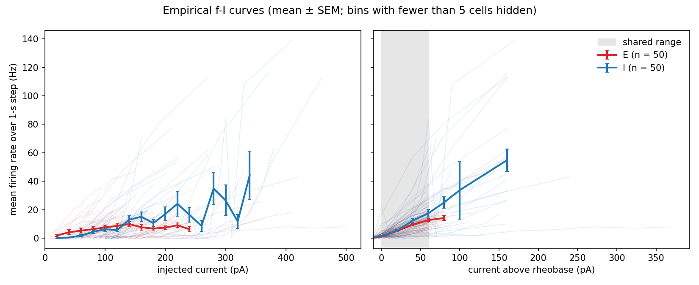
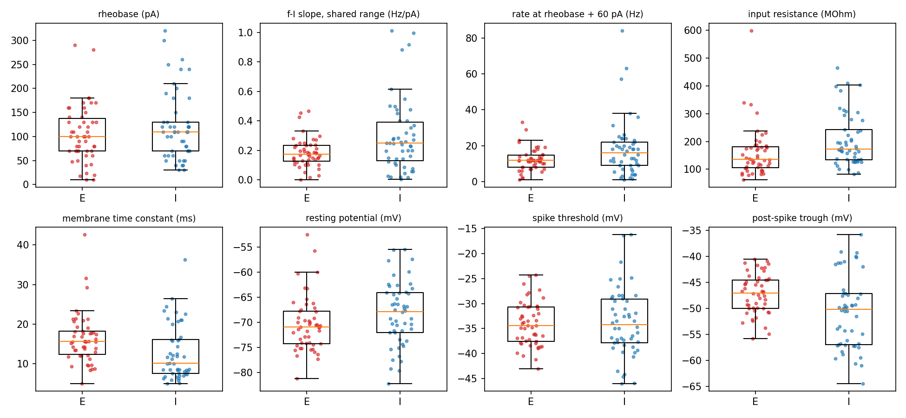
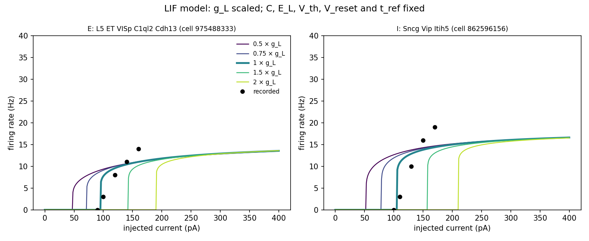
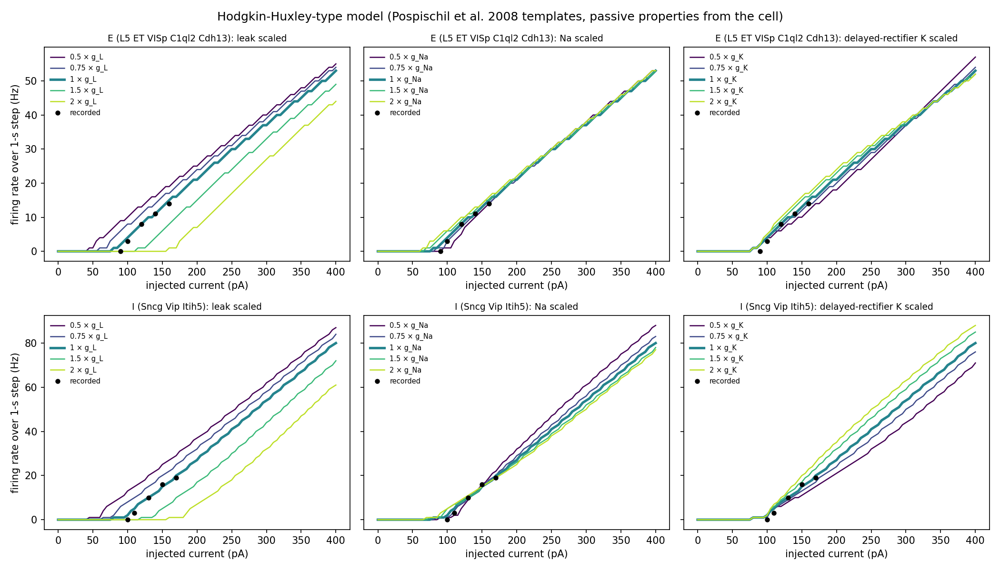
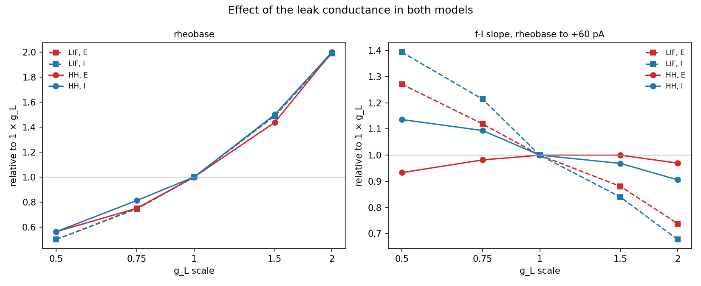

# f-I curves of excitatory and inhibitory neurons, and a leak-conductance perturbation in models

Assignment 14* (computational). Method details and decisions are in [plan.md](plan.md); every number below is produced by the scripts in [scripts/](../scripts/). Figures are written to `results/figures/` (git-ignored; re-create them by running the scripts in order).

## 1. Data

- **Source:** Allen Institute Patch-seq recordings from mouse visual cortex, restricted to cells that have both a current-clamp recording and a transcriptomic type (t-type).
  - Inhibitory (I): Gouwens et al. 2020, DANDI 000020.
  - Excitatory (E): Sorensen et al., with the file manifest from AllenInstitute/exc_vis_manuscript.
- **E/I label:** taken from the t-type subclass (for example `Sst …` → I, `L5 ET …` → E).
- **Sample:** 50 randomly drawn cells per group, 100 NWB files in total (about 3 GB).

| Group | Subclasses in the sample |
|---|---|
| E | L6 21, L5 20, L2/3 4, L4 4, L6b 1 |
| I | Sst 22, Lamp5 11, Pvalb 7, Vip 6, Sncg 3, Serpinf1 1 |

- **Stimulus:** 1-s current steps only.
- **Two recording protocols:**
  - The newer one (42 E, 28 I) stops at about rheobase + 60 pA.
  - The older one (8 E, 21 I, plus 1 I that has both) goes much higher.
- **Quality control:**
  - Sweeps with an unstable or noisy baseline are dropped.
  - Sweeps from aborted recordings (padded with exact zeros) are dropped.
  - All 100 cells pass the cell-level checks.

## 2. Empirical f-I curves



*Thin lines: single cells. Thick lines: mean ± SEM per 20-pA bin, shown only where at least 5 cells contribute. Shaded band: the shared range used for statistics.*

The two panels show the group curves on two different x-axes:

- **Absolute current (left):** E and I cells start firing at similar currents. Above about 150 pA the I curve rises more steeply and becomes noisy. Only the older-protocol cells reach those currents, so this part of the curve rests on fewer, different cells.
- **Current above rheobase (right):** within the shared range, I cells fire faster for the same extra current. Beyond it, the E curve is based on only a few cells.

Comparison of the cell features over the shared range (two-sided Mann-Whitney U test):

| Feature | Median E | Median I | p (all, 50/50) | p (newer protocol only, 42/28) |
|---|---|---|---|---|
| f-I slope, rheobase to +60 pA (Hz/pA) | 0.175 | 0.248 | 0.022 | 0.011 |
| Rate at rheobase + 60 pA (Hz) | 12 | 16 | 0.052 | 0.008 |
| Rheobase (pA) | 100 | 110 | 0.47 | 0.41 |
| Input resistance (MΩ) | 136 | 172 | 0.004 | 0.015 |
| Membrane time constant (ms) | 15.6 | 10.1 | 0.001 | 0.036 |
| Resting potential (mV) | −70.9 | −67.9 | 0.050 | 0.12 |
| Spike threshold (mV) | −34.4 | −34.3 | 0.94 | 0.20 |
| Post-spike trough (mV) | −47.1 | −50.2 | 0.003 | 0.011 |



What the comparison shows:

- E and I cells have about the same rheobase.
- I cells have a steeper f-I curve.
- I cells have a higher input resistance (that is, a lower total leak) and a shorter time constant.
- I cells have a deeper post-spike trough.
- Restricting the comparison to cells recorded with the same (newer) protocol gives the same picture, so the result is not caused by protocol mixing.
- No correction for multiple comparisons was applied. With a Bonferroni correction for 8 features, the slope difference (p = 0.022) would not survive. The input resistance, time constant and trough differences would.

## 3. Leak-conductance perturbation in models

### Representative cells

For each group, the representative is the cell closest to the group median in rheobase and shared-range slope:

| | Cell | t-type | $R_{in}$ (MΩ) | $\tau_m$ (ms) | $E_L$ (mV) | Rheobase (pA) |
|---|---|---|---|---|---|---|
| E | 975488333 | L5 ET VISp C1ql2 Cdh13 | 92 | 16.2 | −63.3 | 100 |
| I | 862596156 | Sncg Vip Itih5 | 157 | 10.0 | −71.3 | 110 |

Both models take $g_L = 1/R_{in}$, $C = \tau_m/R_{in}$ and $E_L$ directly from the cell. Each perturbation scales a single conductance by 0.5, 0.75, 1, 1.5 or 2 and keeps everything else fixed, including $C$.

### Leaky integrate-and-fire (LIF)



The fit:

- $V_{th}$ is set so that the model's rheobase matches the cell's. $V_r$ and $t_{ref}$ are then fitted to the recorded points. Fitted values: E $V_r$ = −83 mV, $t_{ref}$ = 62 ms; I $V_r$ = −91 mV, $t_{ref}$ = 54 ms.
- The fit is poor (RMSE 2.6 Hz for E, 4.4 Hz for I). The LIF has no adaptation, so its rate jumps at rheobase and then saturates. The 1-s mean rate of the real cells instead rises gradually.
- The long $t_{ref}$ is therefore an effective parameter that stands in for adaptation, not a real refractory period.

Effect of the leak:

- Rheobase is exactly proportional to $g_L$ ($I_{rh} = g_L(V_{th}-E_L)$).
- More leak also lowers the shared-range slope:
  - E: ×1.27 at half the leak, ×0.74 at double the leak.
  - I: ×1.39 and ×0.68.

### Hodgkin–Huxley-type model (Na, K and M channels)

**Model:**

- Single compartment.
- Na and delayed-rectifier K channels with Traub-type kinetics, plus a slow M-type K current. These are the minimal cortical models of Pospischil et al. 2008.
- Templates: "regular spiking" for E and "fast spiking" for I.
- Channel densities are scaled to the cell's membrane area.

**Fitted parameters** (grid search over the kinetic offset $V_T$ and $\bar g_M$):

| | Template | $V_T$ (mV) | $\bar g_M$ (nS) | RMSE (Hz) |
|---|---|---|---|---|
| E | RS | −60 | 8.8 | 1.1 |
| I | FS | −64 | 12.7 | 1.4 |

**Fit quality:**

- The fit is much better than the LIF fit because the M current produces the gradual rate increase.
- The I representative is a Sncg/Vip cell, which is not fast spiking. The fit accordingly gives the FS template a substantial M current.
- The model fires single spikes from about 80 pA, so its rheobase is 20–30 pA below the recorded one.



| Scaled conductance | Rheobase (×0.5 → ×2) | Shared-range slope (×0.5 → ×2) |
|---|---|---|
| Leak $g_L$ | E 45 → 160 pA, I 45 → 160 pA | E 0.169 → 0.176 Hz/pA (≤ 7 % change), I 0.238 → 0.190 Hz/pA |
| Na $\bar g_{Na}$ | E 95 → 65 pA, I 90 → 70 pA | E 0.221 → 0.159 Hz/pA, I 0.273 → 0.185 Hz/pA |
| Delayed-rectifier K $\bar g_K$ | unchanged (80 pA) | E 0.137 → 0.233 Hz/pA, I 0.167 → 0.282 Hz/pA |

What each conductance does in the HH-type model:

- **Leak:** shifts the curve sideways. Rheobase scales almost proportionally, while the gain barely changes (E) or changes modestly (I, from +13 % to −10 %).
- **Na:** acts mainly near threshold. At higher currents the curves almost overlap.
- **Delayed-rectifier K:** leaves rheobase unchanged and changes the gain. Faster repolarisation allows faster repetitive firing.

### LIF vs HH: does leak act the same way?



- **Rheobase:** both models agree that leak sets the rheobase, roughly in proportion to $g_L$.
- **Slope:** they disagree.
  - In the LIF, more leak clearly lowers the gain (by up to about 30 %).
  - In the HH-type model, the effect on gain is small for E and moderate for I.
  - The LIF's gain change comes from the leak current at $V_r$, which grows with $g_L$. In the HH-type model, the inter-spike trajectory is dominated by the K and M currents, so leak contributes relatively less. Overall, leak acts mainly subtractively (a threshold shift) rather than divisively, consistent with Holt & Koch (1997).

**Can a leak change alone turn the E curve into the I curve?**

- The I cells have about 20 % less leak than the E cells (median $R_{in}$ 172 vs 136 MΩ).
- In the models, a 0.75 × $g_L$ change lowers rheobase by about 20–25 %. It raises the slope by 12–21 % in the LIF and by under 10 % in the HH-type model.
- The empirical E/I slope difference is about 40 %, and the rheobase is the same.
- So leak alone cannot explain the E/I difference. In the HH-type model the slope difference would need different K-channel properties (delayed-rectifier K and M current), which is consistent with the different post-spike troughs.

## 4. Caveats

- **This is not plasticity.** The model part asks "what if $g_L$ were different?" for one cell. It does not show that any recorded cell changed its leak in response to activity.
- **One cell per group.** Each model is fitted to a single representative cell, and its f-I points are few (4 per cell in the shared range). Other cells of the same group may respond differently, especially across subclasses: the I group is mostly Sst cells, while the representative is a Sncg cell.
- **The sample is not balanced.**
  - E is dominated by deep-layer cells (L5/L6) and I by Sst cells, reflecting the Patch-seq datasets rather than the cortex.
  - Group differences therefore mix subclass composition with the E/I distinction.
- **Protocol mixing.**
  - The newer protocol stops at rheobase + 60 pA and samples rheobase in coarser steps. This is why the statistics use only the shared range, and why the newer-protocol-only check is reported.
  - The group curve against absolute current is biased at high currents: only some cells, mostly older-protocol I cells, are recorded there.
- **Measurement definitions.**
  - Spike threshold uses a fixed $dV/dt$ of 20 mV/ms. This lies above the Allen definition, so absolute threshold values are a few mV higher.
  - Passive properties come from hyperpolarising steps and may miss active conductances near rest.
- **Model simplifications.**
  - The LIF $t_{ref}$ is an effective parameter standing in for adaptation.
  - The HH-type model uses literature kinetics and template Na/K densities. Only $V_T$ and $\bar g_M$ are fitted, so its absolute rates are approximate.
  - Both models are single-compartment, so dendrites and axon-initial-segment effects are absent.
- **Statistics.** No multiple-comparison correction was applied (see the note in section 2).

## Reproduce

From `assignment/`:

```
pip install -e .[dev]
python scripts/01_fetch_data.py         # about 3 GB download
python scripts/02_build_fi_curves.py
python scripts/03_leak_perturbation.py
python scripts/04_hh_model.py
pytest
```

## References

- Gouwens N. W. et al. (2020). Integrated morphoelectric and transcriptomic classification of cortical GABAergic cells. *Cell* 183, 935–953.
- Sorensen S. A., Gouwens N. W. et al. Mouse excitatory visual cortex Patch-seq and whole-neuron morphology. bioRxiv doi:10.1101/2023.11.25.568393.
- Pospischil M. et al. (2008). Minimal Hodgkin–Huxley type models for different classes of cortical and thalamic neurons. *Biological Cybernetics* 99, 427–441.
- Holt G. R. & Koch C. (1997). Shunting inhibition does not have a divisive effect on firing rates. *Neural Computation* 9, 1001–1013.
