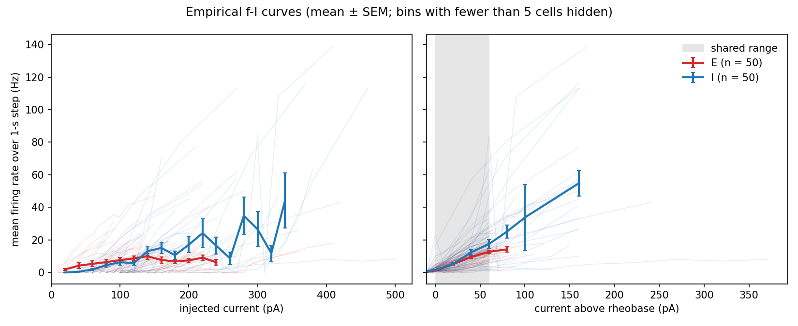
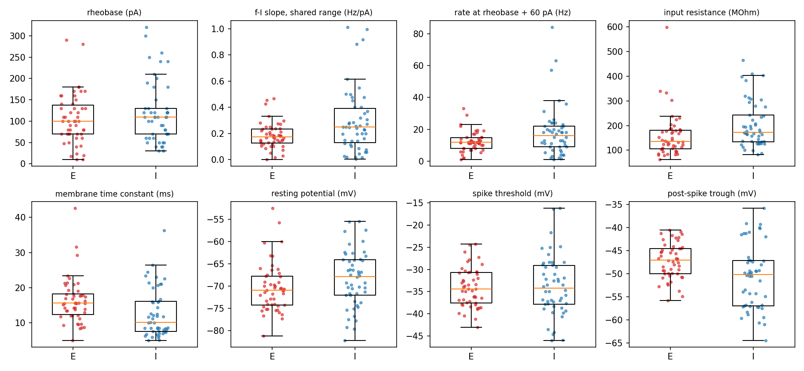
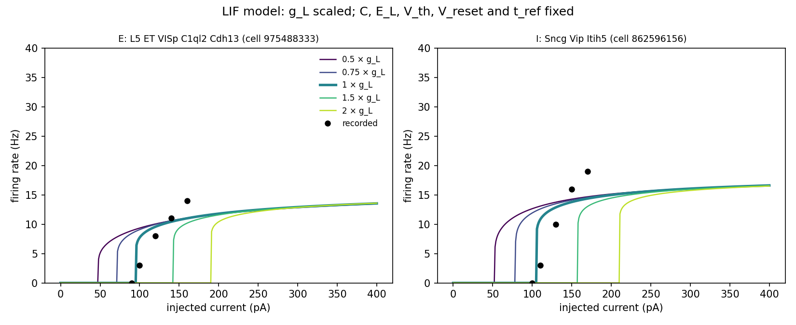
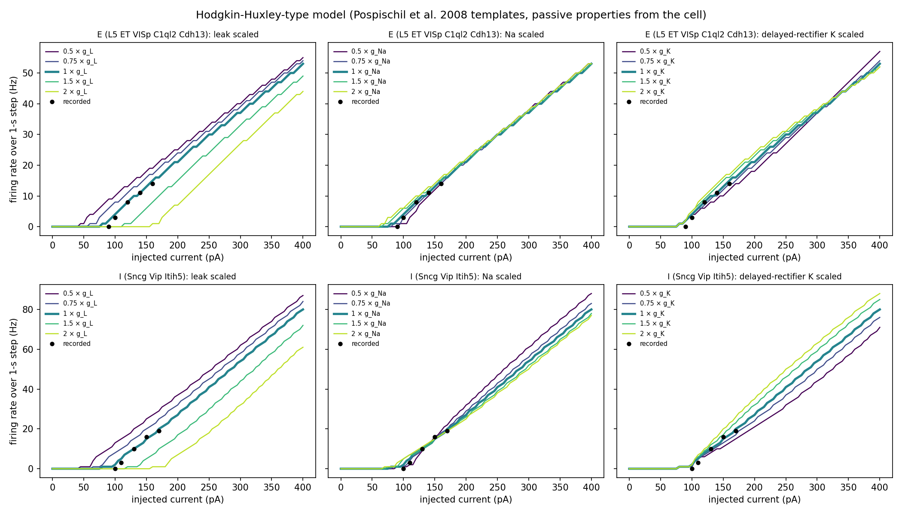
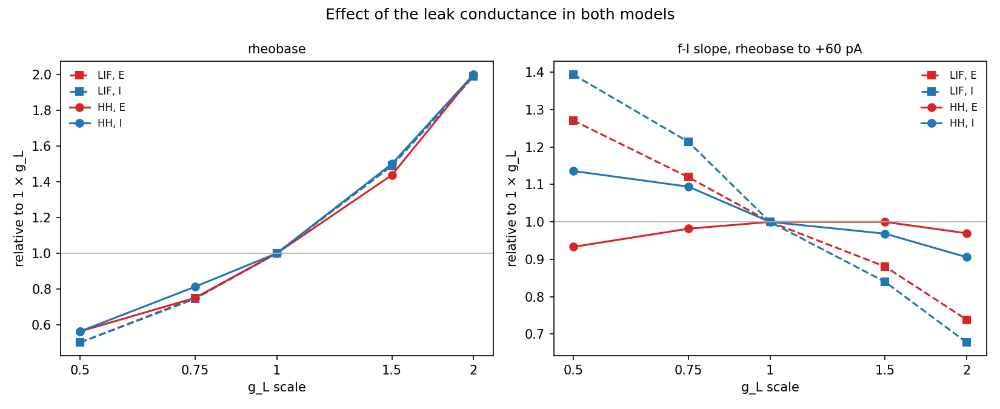

# f-I curves of excitatory and inhibitory neurons, and a leak-conductance perturbation in models

Assignment 14* (computational). Sections 1–3 answer the three tasks of the assignment in order, and section 4 summarises the answers. Method details and decisions are in [plan.md](plan.md). Every number and figure comes from the scripts in [scripts/](../scripts/), run in order 01–04.

## 1. Task 1: Patch-seq cells with both electrophysiology and transcriptomic data

- **Source:** Allen Institute Patch-seq recordings from mouse visual cortex. Only cells that have both a current-clamp recording (NWB file on DANDI) and a transcriptomic type (t-type) are used.
  - Inhibitory cells: Gouwens et al. 2020, DANDI 000020.
  - Excitatory cells: Sorensen et al., with the file manifest from AllenInstitute/exc_vis_manuscript.
- **Sample:** 50 randomly drawn cells per group, 100 NWB files in total (about 3 GB).
- **Stimulus:** 1-s current steps only. They come from two recording protocols:
  - The newer protocol (42 E, 28 I) stops at about rheobase + 60 pA.
  - The older protocol (8 E, 21 I, plus 1 I cell recorded with both) goes much higher.
- **Quality control:** sweeps with an unstable or noisy baseline, and sweeps from aborted recordings (padded with exact zeros), are dropped. All 100 cells pass the cell-level checks.

The snippets in this report are condensed from [src/fi_analysis/](../src/fi_analysis/) and run from `assignment/` after scripts 01–02.

<details><summary>How the cells are selected</summary>

```python
from fi_analysis import data_access
from fi_analysis.cell_class import classify_ttype

# Joins the t-type tables with the ephys file lists: only cells with BOTH modalities survive.
cells = data_access.load_cells()
cells["cell_class"] = cells["t_type"].map(classify_ttype)   # "E", "I" or None (non-neuronal)
sample = (
    cells.dropna(subset=["cell_class"])
    .sample(frac=1, random_state=0)   # fixed seed: the same 100 cells on every run
    .groupby("cell_class").head(50)   # first 50 E and first 50 I of the shuffled table
)
```

</details>

<details><summary>How the current-clamp sweeps are read from an NWB file</summary>

```python
import h5py
from fi_analysis import config

with h5py.File("data/raw/975488333.nwb", "r") as f:   # file name = ephys session ID
    for sweep in f["acquisition"].values():
        if sweep.attrs.get("neurodata_type") != "CurrentClampSeries":
            continue
        stimulus = sweep.attrs["stimulus_description"]
        if not stimulus.startswith(config.LONG_SQUARE_STIMULI):
            continue                    # keep only the 1-s current-step protocols
        v_mv = sweep["data"][:] * sweep["data"].attrs["conversion"] * 1e3   # stored in V, converted to mV
        print(sweep.attrs["sweep_number"], stimulus)

# 4-8   X1PS_SubThresh_DA_0      (hyperpolarising/subthreshold steps)
# 16-17 X3LP_Rheo_DA_0           (steps around rheobase)
# 18-20 X4PS_SupraThresh_DA_0    (suprathreshold steps)
```

The full loader ([ephys.py](../src/fi_analysis/ephys.py)) also reads the injected current from `stimulus/presentation`, checks that the step lasts 1 s, and drops aborted sweeps.

</details>

## 2. Task 2: E/I classification from transcriptomic labels and empirical f-I curves

### 2.1 Classification

Each cell's E/I label comes from its t-type subclass (for example `Sst …` → I, `L5 ET …` → E).

<details><summary>How a t-type is turned into an E/I label</summary>

```python
from fi_analysis.cell_class import classify_ttype

# Only the first word of the t-type (the subclass) matters:
# a GABAergic subclass (Lamp5, Sncg, Vip, Sst, Pvalb, Serpinf1, Meis2) -> I, a layer name (L2/3, L5, ...) -> E.
classify_ttype("L5 ET VISp C1ql2 Cdh13")   # 'E'
classify_ttype("Sncg Vip Itih5")           # 'I'
classify_ttype("Astro Aqp4")               # None: non-neuronal, excluded
```

</details>

| Group | Subclasses in the sample |
|---|---|
| E | L6 21, L5 20, L2/3 4, L4 4, L6b 1 |
| I | Sst 22, Lamp5 11, Pvalb 7, Vip 6, Sncg 3, Serpinf1 1 |

The groups are not balanced across subclasses. E is dominated by deep-layer cells (L5/L6) and I by Sst cells, which reflects the Patch-seq datasets rather than the cortex. The E/I differences below therefore also partly reflect subclass composition.

### 2.2 Empirical f-I curves



*Thin lines: single cells. Thick lines: group mean ± SEM in 20-pA current bins (each cell averaged within a bin first); bins with fewer than 5 cells are hidden. Grey band (right panel): rheobase to rheobase + 60 pA, the range every cell covers, used for all statistics.*

- **Absolute current (left):** E and I cells start firing at similar currents. Above about 150 pA the I curve rises more steeply but only older-protocol cells reach these currents, so this part rests on fewer, different cells.
- **Current above rheobase (right):** within the shared range, I cells fire faster for the same extra current.

<details><summary>How one cell's f-I curve, rheobase and slope are obtained (E representative)</summary>

```python
import numpy as np
import pandas as pd

# One row per cell and step amplitude; rate = spikes during the 1-s step / 1 s (repeats averaged).
points = pd.read_csv("data/processed/fi_points.csv")
fi = points[points["cell_id"] == 975488333]
# current_pa:  90  100  120  140  160
# rate_hz:      0    3    8   11   14

rheobase = fi.loc[fi["rate_hz"] > 0, "current_pa"].min()          # lowest step with a spike: 100 pA
shared = fi[fi["current_pa"].between(rheobase, rheobase + 60)]   # shared range: 100-160 pA, 4 points
slope = np.polyfit(shared["current_pa"], shared["rate_hz"], 1)[0]  # linear fit: 0.18 Hz/pA
```

Spikes are upward crossings of $dV/dt$ = 20 mV/ms that reach at least −20 mV ([ephys.py](../src/fi_analysis/ephys.py)).

</details>

### 2.3 E vs I comparison

Features are compared over the shared range with a two-sided Mann-Whitney U test, for all cells and again for the newer-protocol cells only, to rule out protocol mixing.

| Feature | Median E | Median I | p (all, 50/50) | p (newer protocol only, 42/28) |
|---|---|---|---|---|
| f-I slope, rheobase to +60 pA (Hz/pA) | 0.175 | 0.248 | 0.022 | 0.011 |
| Rate at rheobase + 60 pA (Hz) | 12 | 16 | 0.052 | 0.008 |
| Rheobase (pA) | 100 | 110 | 0.47 | 0.41 |
| Input resistance (MΩ) | 136 | 172 | 0.004 | 0.015 |
| Membrane time constant (ms) | 15.6 | 10.1 | 0.001 | 0.036 |
| Resting potential (mV) | −70.9 | −67.9 | 0.050 | 0.12 |
| Spike threshold (mV) | −34.4 | −34.3 | 0.94 | 0.20 |
| Post-spike trough (mV) | −47.1 | −50.2 | 0.003 | 0.011 |

<details><summary>How a p-value in the table is computed (f-I slope)</summary>

```python
import pandas as pd
from scipy.stats import mannwhitneyu

cells = pd.read_csv("data/processed/cell_summaries.csv")   # one row per cell, all features
e = cells.loc[cells["cell_class"] == "E", "fi_slope_shared_hz_per_pa"]
i = cells.loc[cells["cell_class"] == "I", "fi_slope_shared_hz_per_pa"]
# Rank-based test: no normality assumption, robust to the outliers in the feature plots.
mannwhitneyu(e, i, alternative="two-sided").pvalue   # 0.022
```

</details>



- E and I cells have about the same rheobase, but the I f-I curve is about 40 % steeper.
- I cells have a higher input resistance (less total leak, about 20 %), a shorter time constant and a deeper post-spike trough.
- The newer-protocol-only comparison gives the same picture, so the differences are not caused by protocol mixing.
- No correction for multiple comparisons was applied. With a Bonferroni correction for 8 features the slope difference (p = 0.022) would not survive; the input resistance, time constant and trough differences would.

## 3. Task 3: Leak-conductance perturbation in LIF and HH-type models

This part is a model-based "what if $g_L$ were different?" for one representative cell per group. It is not evidence that any recorded cell changed its leak through activity-dependent plasticity.

### 3.1 Representative cells and setup

For each group, the representative is the cell closest to the group median in rheobase and shared-range slope:

| | Cell | t-type | $R_{in}$ (MΩ) | $\tau_m$ (ms) | $E_L$ (mV) | Rheobase (pA) |
|---|---|---|---|---|---|---|
| E | 975488333 | L5 ET VISp C1ql2 Cdh13 | 92 | 16.2 | −63.3 | 100 |
| I | 862596156 | Sncg Vip Itih5 | 157 | 10.0 | −71.3 | 110 |

"Cell" is the ephys session ID, which is also the NWB file name. The Allen specimen IDs, used on celltypes.brain-map.org, are 975488447 (E) and 862596299 (I).

<details><summary>How the representative cells are chosen and where their parameters come from</summary>

```python
import pandas as pd

cells = pd.read_csv("data/processed/cell_summaries.csv")
for cls, group in cells.groupby("cell_class"):
    x = group[["rheobase_pa", "fi_slope_shared_hz_per_pa"]]
    z = (x - x.median()) / x.std(ddof=0)                 # distance from the group median, in SDs
    rep = group.loc[z.pow(2).sum(axis=1).idxmin()]       # cell closest to the median in both features
    print(cls, rep["cell_id"], rep["t_type"])

# E 975488333 L5 ET VISp C1ql2 Cdh13   (distance 0.003; next: another L5 ET cell, 0.011)
# I 862596156 Sncg Vip Itih5           (distance 0.008; next: an Sst cell, 0.020)
```

The other table columns are measured per cell in [ephys.py](../src/fi_analysis/ephys.py):

- $R_{in}$: slope of the steady-state voltage change against current over the hyperpolarising steps.
- $\tau_m$: exponential fit from the onset of a hyperpolarising step to 90 % of its peak (median over steps).
- $E_L$: median membrane potential in the 100 ms before the steps.

</details>

- Both models take $g_L = 1/R_{in}$, $C = \tau_m/R_{in}$ and $E_L$ directly from the cell.
- Each perturbation scales one conductance by 0.5, 0.75, 1, 1.5 or 2 and keeps everything else fixed, including $C$.
- One cell per group, with only 4 f-I points each in the shared range, so other cells may respond differently. The I representative is a Sncg cell, while the I group is mostly Sst; the runner-up was an Sst cell, so this choice is a close call.

### 3.2 Leaky integrate-and-fire (LIF) model



- **Fit:** $V_{th}$ is set so the model's rheobase matches the cell's. $V_r$ and $t_{ref}$ are fitted to the recorded points (E: −83 mV, 62 ms; I: −91 mV, 54 ms).
- **Fit quality:** poor (RMSE 2.6 Hz for E, 4.4 Hz for I). The LIF has no adaptation, so its rate jumps at rheobase and then saturates, while the real cells' rate rises gradually. The long $t_{ref}$ is an effective stand-in for adaptation, not a real refractory period.
- **Effect of leak:**
  - Rheobase is exactly proportional to $g_L$ ($I_{rh} = g_L(V_{th}-E_L)$).
  - More leak also lowers the shared-range slope: E ×1.27 at half the leak and ×0.74 at double the leak; I ×1.39 and ×0.68.

<details><summary>How the leak perturbation is run (E representative)</summary>

```python
from dataclasses import replace

import numpy as np
import pandas as pd
from fi_analysis.model import fit_lif, lif_rate_hz, passive_parameters

rep = {"cell_id": 975488333, "R_in": 92.4, "tau": 16.2, "E_L": -63.3}   # from the table in 3.1
points = pd.read_csv("data/processed/fi_points.csv")
fi = points[points["cell_id"] == rep["cell_id"]]

g_L, C = passive_parameters(rep["R_in"], rep["tau"])   # g_L = 1/R_in = 10.8 nS, C = tau_m * g_L = 175 pF
# Fits only V_th, V_reset and t_ref to the recorded f-I points; C, g_L and E_L stay as measured.
base = fit_lif(fi["current_pa"], fi["rate_hz"], C=C, g_L=g_L, E_L=rep["E_L"])

currents = np.arange(0, 401)   # pA
for scale in (0.5, 0.75, 1.0, 1.5, 2.0):
    model = replace(base, g_L=base.g_L * scale)   # the perturbation: ONLY g_L changes
    rates = lif_rate_hz(currents, model)           # analytic LIF rate for each constant current
    print(scale, model.rheobase)                   # g_L * (V_th - E_L)

# 0.5 -> 47.5 pA, 0.75 -> 71.3 pA, 1 -> 95 pA, 1.5 -> 142.5 pA, 2 -> 190 pA: rheobase proportional to g_L
```

The model rheobase at ×1 (95 pA) lies midway between the last silent step (90 pA) and the first spiking step (100 pA). The HH-type model is perturbed the same way, by scaling one conductance in a copy of the fitted parameters ([model.py](../src/fi_analysis/model.py)).

</details>

### 3.3 Hodgkin–Huxley-type model (Na, K and M channels)

- **Model:** single compartment with Na and delayed-rectifier K channels (Traub-type kinetics) and a slow M-type K current, from the minimal cortical models of Pospischil et al. 2008. Templates: "regular spiking" for E, "fast spiking" for I. Channel densities are scaled to the cell's membrane area.
- **Fit:** grid search over the kinetic offset $V_T$ and $\bar g_M$; the other kinetics and densities come from the literature, so absolute rates are approximate.

| | Template | $V_T$ (mV) | $\bar g_M$ (nS) | RMSE (Hz) |
|---|---|---|---|---|
| E | RS | −60 | 8.8 | 1.1 |
| I | FS | −64 | 12.7 | 1.4 |

- **Fit quality:** much better than the LIF, because the M current produces the gradual rate increase. The model's rheobase is 20–30 pA below the recorded one.



| Scaled conductance | Rheobase (×0.5 → ×2) | Shared-range slope (×0.5 → ×2) |
|---|---|---|
| Leak $g_L$ | E 45 → 160 pA, I 45 → 160 pA | E 0.169 → 0.176 Hz/pA (≤ 7 % change), I 0.238 → 0.190 Hz/pA |
| Na $\bar g_{Na}$ | E 95 → 65 pA, I 90 → 70 pA | E 0.221 → 0.159 Hz/pA, I 0.273 → 0.185 Hz/pA |
| Delayed-rectifier K $\bar g_K$ | unchanged (80 pA) | E 0.137 → 0.233 Hz/pA, I 0.167 → 0.282 Hz/pA |

- **Leak:** shifts the curve sideways. Rheobase scales almost proportionally, while the gain barely changes (E) or changes modestly (I, from +13 % to −10 %).
- **Na and K (for comparison):** Na acts mainly near threshold; delayed-rectifier K leaves rheobase unchanged and changes the gain.

### 3.4 Comparison: does leak act the same way in both models, and can it explain the E/I difference?



- **Rheobase:** both models agree that leak sets the rheobase, roughly in proportion to $g_L$.
- **Slope:** they disagree. In the LIF more leak lowers the gain by up to about 30 %, because the leak current at $V_r$ grows with $g_L$. In the HH-type model the inter-spike trajectory is dominated by the K and M currents, so leak has little effect on the gain. Leak therefore acts mainly subtractively (a threshold shift) rather than divisively, consistent with Holt & Koch (1997).
- **Leak alone cannot turn the E curve into the I curve:**
  - The I cells have about 20 % less leak than the E cells. In the models, 0.75 × $g_L$ lowers rheobase by about 20–25 % and raises the slope by 12–21 % (LIF) or under 10 % (HH-type).
  - The data instead show the same rheobase and a slope about 40 % higher.
  - In the HH-type model a slope difference of that size needs different K-channel properties (delayed-rectifier K and M current), which fits the deeper post-spike trough of the I cells.

## 4. Summary

- **Task 1 (data):** 100 Allen Patch-seq cells from mouse visual cortex (50 E, 50 I) with both a current-clamp recording and a t-type; 1-s current steps; all cells pass QC.
- **Task 2 (E/I f-I curves):** E and I cells start firing at the same current (rheobase 100 vs 110 pA), but I cells have a steeper f-I curve (0.248 vs 0.175 Hz/pA), a higher input resistance, a shorter time constant and a deeper post-spike trough. The result holds within a single recording protocol; the slope difference alone would not survive a Bonferroni correction.
- **Task 3 (leak perturbation):** in both models leak mainly sets the rheobase, roughly in proportion to $g_L$, and so shifts the f-I curve sideways. Its effect on the gain depends on the model: up to about 30 % in the LIF, small in the HH-type model.
- **Main conclusion:** the lower leak of I cells cannot by itself explain their steeper f-I curve. In the HH-type model the gain is set mainly by K conductances, so the E/I difference more likely involves K-channel properties. This is a model-based hypothesis: the simulations perturb one fitted cell per group and do not show activity-dependent plasticity in the recorded cells.

## Reproduce

From `assignment/`:

```
pip install -e .[dev]
python scripts/01_fetch_data.py         # about 3 GB download
python scripts/02_build_fi_curves.py
python scripts/03_leak_perturbation.py
python scripts/04_hh_model.py
pytest
```

## References

- Gouwens N. W. et al. (2020). Integrated morphoelectric and transcriptomic classification of cortical GABAergic cells. *Cell* 183, 935–953.
- Sorensen S. A., Gouwens N. W. et al. Mouse excitatory visual cortex Patch-seq and whole-neuron morphology. bioRxiv doi:10.1101/2023.11.25.568393.
- Pospischil M. et al. (2008). Minimal Hodgkin–Huxley type models for different classes of cortical and thalamic neurons. *Biological Cybernetics* 99, 427–441.
- Holt G. R. & Koch C. (1997). Shunting inhibition does not have a divisive effect on firing rates. *Neural Computation* 9, 1001–1013.
